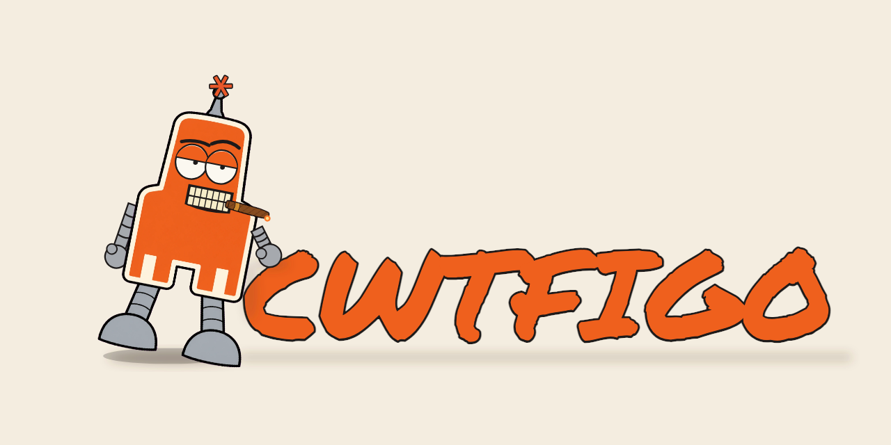
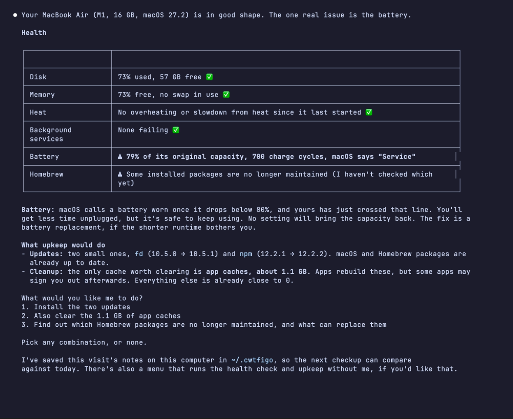
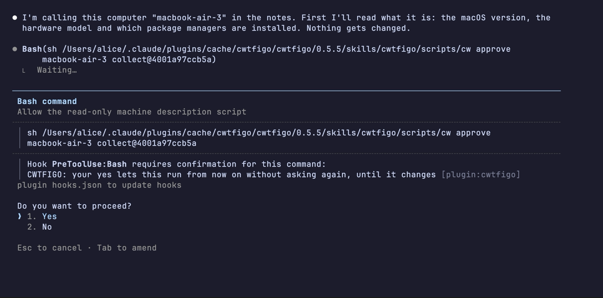
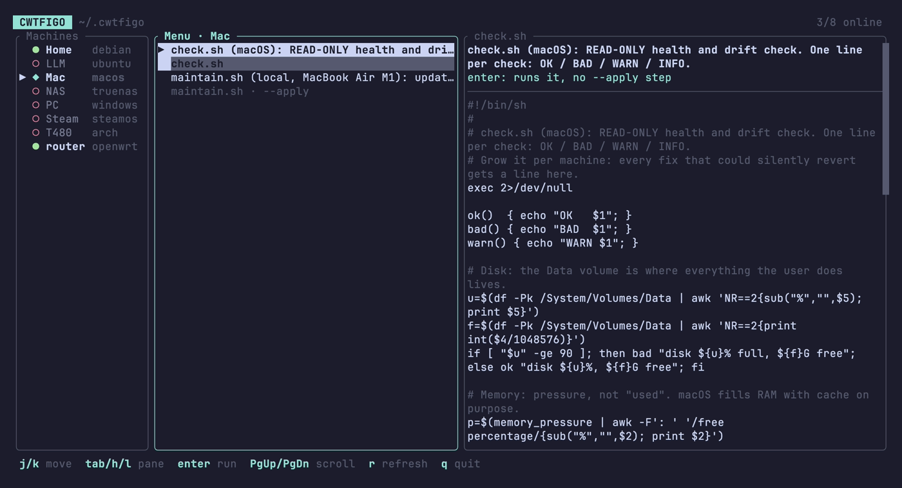

<p align="center">
  <picture>
    <source media="(prefers-color-scheme: dark)" srcset="assets/banner-dark.png">
    
  </picture>
</p>

# CWTFIGO

**Claude, what the fuck is going on?**

Your computer acts up and you don't know why. Call Claude by name: it looks, tells you in plain words what's wrong, fixes it once you say OK, and remembers that machine for next time.

A plugin for [Claude Code](https://claude.com/claude-code) ([website](https://cwtfigo.diamonddoge.org) · [中文](https://cwtfigo.diamonddoge.org/zh/)). Macs, Linux, Windows, Steam Deck, routers, the one in front of you or others on your network over SSH.



## Install

In Claude Code, paste one line at a time:

```
/plugin marketplace add DozenTwelve/CWTFIGO
/plugin install cwtfigo@cwtfigo
```

Then run `/reload-plugins` (or restart Claude Code) and type `cwtfigo`. If it offers you a checkup of this computer, it's working.

It needs `git` (on a Mac: `xcode-select --install`; on Windows it runs in Git Bash, which Claude Code needs there anyway) and `python3` to search past fixes. The first visit goes best on Opus (`/model opus`).

## How it works

You say the name and what's wrong:

> CWTFIGO, why is my laptop at 90°C every day?
>
> what the fuck is going on with the server
>
> 一体どうなってやがるんだ、Wi-Fiがすぐ切れる

Or just `cwtfigo`, and it offers a checkup: disk, memory, battery, heat, failed services, pending updates, how much space a cleanup would free.

There's no fixed script library. Claude writes each machine's scripts on the spot, for that machine: its OS, what's installed, what you told it not to touch. It starts from a short template per OS and, where open-source projects already keep the data (which files an app leaves behind, where games keep saves, how each package manager upgrades), it reads theirs instead of guessing. It reads them; it never downloads and runs their code.

Before a script reads anything new, Claude Code asks you. Say yes once, and that script runs from then on without asking, until it changes. Anything that would change your computer (an update, a cleanup, a fix) asks every time, and shows you first what it would do.

What it learns goes into notes on your computer, one folder per machine: what it is, what went wrong, what fixed it, a health check that grows with every fix. The next visit starts from there, so the same question costs less, and a fix that quietly comes undone shows up in the next check.



## Why not just ask Claude?

- **It remembers.** Without notes, every chat starts from zero: what this machine is, what you tried last month.
- **It asks before it reads.** A script runs only after your yes, checked by its fingerprint: if it changes, it asks again.
- **Scripts written for your machine, kept.** Each machine gets its own health check and upkeep script, written by Claude for that machine and approved by you, then rerun every visit and rewritten when something new is learned.
- **Many machines.** Your laptop can look after your server, your NAS and your router over SSH, with the notes for all of them in one place.
- **No AI needed afterwards.** A small terminal menu runs your approved checks and upkeep without Claude.

## Without AI: the menu



It shows the scripts Claude has written and you've approved, machine by machine, so on day one it's empty: it fills as you use CWTFIGO. Mac and Linux. In Claude Code, say "CWTFIGO install the TUI", then type `cwtfigo` in a terminal.

Without Claude Code at hand, this gets the newest release instead:

```
mkdir -p ~/.local/bin && curl -fsSL https://github.com/DozenTwelve/CWTFIGO/releases/latest/download/cwtfigo-tui-$(uname -s)-$(uname -m).tar.gz | tar -xz -C ~/.local/bin cwtfigo
```

Then type `cwtfigo`. If the terminal says it's not found, `~/.local/bin` isn't on your `PATH` yet (a Mac doesn't have it there by default). Add it and open a new terminal (on Linux with bash, `~/.bashrc` instead of `~/.zshrc`):

```
echo 'export PATH="$HOME/.local/bin:$PATH"' >> ~/.zshrc
```

When the plugin updates, the menu offers `u` to follow it. More in [`tui/README.md`](tui/README.md).

## Privacy

- The notes live in `~/.cwtfigo`, a git folder on your computer. Delete it and they're gone. Several computers can share them through a private git remote you own; never a public one.
- What Claude reads (names, paths, ports, log lines) passes through Anthropic like anything else you show Claude Code. For a cleanup it measures sizes, never what's in your files.
- It only starts when you call it by name. Describe a problem without the name and you get a normal Claude answer; it never touches a machine you didn't point it at.

## When something goes wrong

Tell it: "CWTFIGO, that didn't work", or "CWTFIGO, open an issue about this". It drafts a bug report with the version and what happened, shows it to you, and posts it under your GitHub account only on your yes. Posting needs GitHub's `gh` tool, installed and logged in (`gh auth login`). Or open one yourself: [new issue](https://github.com/DozenTwelve/CWTFIGO/issues/new/choose). Security problems: see [SECURITY.md](SECURITY.md).

<details>
<summary>Install from a clone, to change it while you use it</summary>

In a terminal:

```
git clone https://github.com/DozenTwelve/CWTFIGO ~/CWTFIGO
```

Then in Claude Code, one line at a time (the path is where you cloned it; a `./` path counts from the folder Claude Code was started in):

```
/plugin marketplace add ~/CWTFIGO
/plugin install cwtfigo@cwtfigo
```

Then `/reload-plugins`.

</details>

## License

MIT ([LICENSE](LICENSE)). How it behaves, for the curious: [`skills/cwtfigo/SKILL.md`](skills/cwtfigo/SKILL.md).
